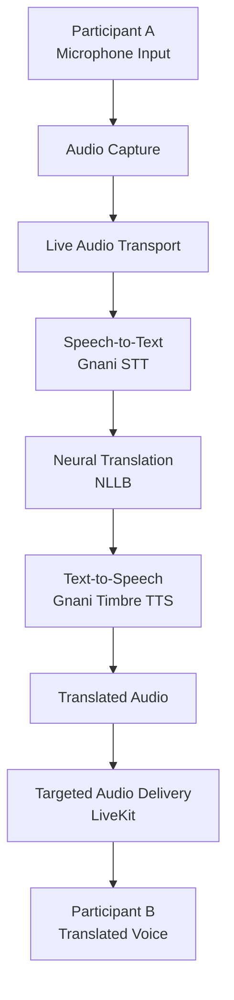

# 🌍 LingoLive — Every Language. One Conversation.

**Real-Time Multilingual Voice Translation Platform**

Break language barriers. Connect people. Communicate naturally.

LingoLive is an AI-powered, real-time multilingual voice communication platform that enables people speaking different languages to communicate through live translated audio.

It captures a participant's speech, converts it into text, translates the recognized content into the listener's preferred language, generates natural-sounding speech, and delivers the translated audio to the intended participant.

The goal is simple: **make language differences invisible during real-time conversations.**

<p align="center">
  <a href="https://lingolive-seven.vercel.app/"><strong>🚀 Live Demo</strong></a> •
  <a href="https://github.com/Vignesh-S-Ai/lingolive"><strong>📂 Source Code</strong></a>
</p>

---

## ✨ Key Features

- 🎙️ **Real-Time Voice Communication** — Communicate using live audio rather than text-only messaging.
- 🌐 **Multilingual Translation** — Translate conversations across Tamil, Hindi, and Telugu.
- 🧠 **AI-Powered Speech Recognition** — Convert incoming speech into text using Gnani STT.
- 🔄 **Neural Machine Translation** — Translate recognized text using Meta's NLLB model.
- 🔊 **Natural Speech Generation** — Generate translated speech using Gnani Timbre TTS.
- ⚡ **Live Audio Delivery** — Deliver translated audio to the intended participant through LiveKit.
- 👥 **Multi-Participant Communication** — Support multiple participants within a shared conversation room.
- 🔗 **WebRTC-Based Communication** — Use LiveKit for real-time audio communication and room management.

---

## 🏗️ System Architecture

LingoLive follows a modular, real-time audio processing architecture.



### Translation Pipeline

1. **Audio Capture:** Capture the participant's microphone input.
2. **Speech Recognition:** Process incoming audio using Gnani Speech-to-Text.
3. **Language Translation:** Translate the recognized text into the target language using NLLB.
4. **Speech Generation:** Convert translated text into speech using Gnani Timbre TTS.
5. **Audio Delivery:** Route the generated audio to the intended participant through LiveKit.

This pipeline enables participants to communicate in their preferred languages without manually translating messages.

---

## 🛠️ Technology Stack

| Layer | Technology |
|---|---|
| Frontend | React, TypeScript |
| Backend | Python, FastAPI |
| Real-Time Communication | LiveKit, WebRTC |
| Communication | WebSockets |
| Speech-to-Text | Gnani Prisma STT |
| Machine Translation | Meta NLLB |
| Text-to-Speech | Gnani Timbre TTS |
| Deployment | Vercel (frontend) |

---

## 🌏 Supported Languages

LingoLive currently focuses on three languages and six directional translation combinations.

| Source Language | Target Language |
|---|---|
| Tamil | Hindi |
| Tamil | Telugu |
| Hindi | Tamil |
| Hindi | Telugu |
| Telugu | Tamil |
| Telugu | Hindi |

The architecture is designed to support additional languages as the translation pipeline evolves.

---

## 🧪 Testing & Validation

The M12 development milestone completed the following reported test suites:

| Test Suite | Result |
|---|---:|
| Backend Unit Tests | 19/19 Passed |
| M11 Integration Tests | 8/8 Passed |
| M12 Pipeline Smoke Tests | 13/13 Passed |
| Three-Participant Browser Acceptance | Passed |

### Validated Capabilities

- Backend health and API connectivity.
- CORS configuration.
- Room creation and participant management.
- LiveKit integration.
- Six directional language translation combinations.
- Gnani STT and TTS integration.
- Multi-participant WebSocket communication.
- Audio-to-text-to-translation-to-audio processing.
- Targeted translated audio delivery.

*These results represent the completed development test milestone. Production deployment behavior and performance should be validated separately.*

---

## 🚀 Getting Started

### Prerequisites

Make sure you have the following installed:

- Node.js
- Python 3.10+
- Git
- A LiveKit account or server
- Required Gnani API credentials
- Access to the NLLB translation model

### 1. Clone the Repository

```bash
git clone https://github.com/Vignesh-S-Ai/lingolive.git
cd lingolive
```

### 2. Configure Environment Variables

Create the appropriate `.env` files for your frontend and backend.

Example configuration:

```env
# LiveKit
LIVEKIT_URL=your_livekit_url
LIVEKIT_API_KEY=your_livekit_api_key
LIVEKIT_API_SECRET=your_livekit_api_secret

# Gnani
GNANI_API_KEY=your_gnani_api_key

# Backend
BACKEND_URL=http://localhost:8000
```

Add any additional variables required by the application.

**Security:** Never commit API keys, secrets, tokens, or private credentials to GitHub. Keep environment files out of version control.

### 3. Start the Backend

Navigate to the backend directory:

```bash
cd backend
```

Create and activate a virtual environment:

```bash
python -m venv venv
```

Windows:

```bash
venv\Scripts\activate
```

Install dependencies:

```bash
pip install -r requirements.txt
```

Start the FastAPI application:

```bash
uvicorn main:app --reload
```

The backend should be available at:

```text
http://localhost:8000
```

### 4. Start the Frontend

Open another terminal:

```bash
cd frontend
npm install
npm run dev
```

Open the local development URL displayed in your terminal.

> Note: Directory names and startup commands should be adjusted if the repository uses a different project structure.

---

## 📁 Project Structure

```text
lingolive/
│
├── frontend/
│   ├── src/
│   ├── public/
│   └── package.json
│
├── backend/
│   ├── main.py
│   ├── requirements.txt
│   └── ...
│
├── README.md
└── .gitignore
```

*This is a conceptual overview. Refer to the actual repository for the complete directory structure.*

---

## ⚙️ Core Engineering Challenges

Building a real-time multilingual voice platform involves more than connecting speech recognition and translation APIs.

Some of the important engineering challenges include:

- **Latency Optimization:** Minimizing the time between a participant speaking and another participant receiving translated audio.
- **Audio Streaming:** Processing audio continuously while maintaining reliable communication.
- **Language Routing:** Identifying the source and target languages for each participant.
- **Targeted Delivery:** Ensuring translated audio reaches the correct participant.
- **Multi-Participant Synchronization:** Managing multiple participants and concurrent audio streams.
- **Reliability:** Handling API failures, connection interruptions, and reconnection scenarios.

---

## 🗺️ Roadmap

- [x] Initial real-time translation architecture.
- [x] Speech-to-text integration.
- [x] NLLB translation integration.
- [x] Text-to-speech integration.
- [x] LiveKit audio delivery.
- [x] Six directional language combinations.
- [x] Multi-participant pipeline validation.
- [ ] Optimize end-to-end translation latency.
- [ ] Improve streaming and partial translation.
- [ ] Expand supported languages.
- [ ] Strengthen production monitoring and error handling.
- [ ] Improve scalability for larger conversations.
- [ ] Complete comprehensive production deployment validation.

---

## 🔐 Security Considerations

- Store API credentials in environment variables.
- Never expose private API keys in frontend code.
- Validate room access and participant permissions.
- Secure WebSocket connections.
- Apply authentication and authorization where required.
- Monitor API usage and prevent abuse.

---

## 🎯 Vision

LingoLive aims to make multilingual communication feel natural.

Whether two people speak different languages, teams collaborate across countries, or communities connect across cultures, language should never become a barrier to meaningful conversations.

**One platform. Multiple languages. One conversation.**

---

## 👨‍💻 Author

**Vignesh Sekar**

AI Engineer | Full-Stack Developer | Building Real-Time AI Systems

- GitHub: https://github.com/Vignesh-S-Ai
- Project: https://github.com/Vignesh-S-Ai/lingolive
- Live Application: https://lingolive-seven.vercel.app/

---

<p align="center">
  <strong>🌍 LingoLive — Every Language. One Conversation.</strong>
  <br/>
  <sub>Built to connect the world, one conversation at a time.</sub>
</p>
